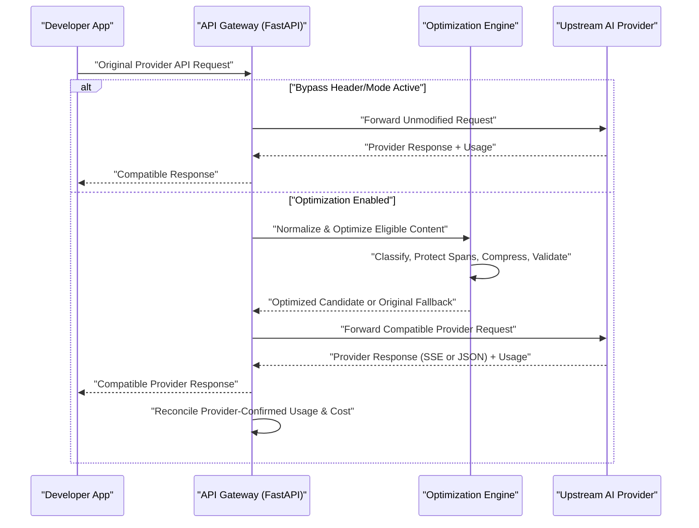

# API Gateway Specification (`apps/api-gateway`)

**Master Reference:** Sections 2, 8, 9.4, 13, 14, 16, and 17 of [token-optimization-platform-architecture.md](../token-optimization-platform-architecture.md).

---

## 1. Purpose and Scope

`apps/api-gateway` is a Python 3.12+ / FastAPI proxy layer (MVP v0.4) that optimizes compatible LLM API requests explicitly routed through the gateway before forwarding them to upstream providers (`openai`, `anthropic`, `google`), then reconciles **provider-reported usage** against pre-flight token estimates.

> **Scope constraint:** The gateway optimizes requests **only** when client applications explicitly route traffic through the gateway base URL.

---

## 2. Request & Response Sequence

---

## 3. Mandatory Gateway Requirements

### 3.1 Provider Routing & Schema Normalization
- Accept OpenAI, Anthropic, and Google request shapes under clear provider route prefixes (`src/routes/`).
- Normalize eligible text blocks (user messages, eligible context attachments, terminal/tool outputs where permitted) into `OptimizationRequest` payloads without altering provider wire compatibility.

### 3.2 Structural & Tool-Contract Invariance (Critical Safety Rule)
The gateway **MUST NEVER** silently alter:
- `tools` / function declarations and parameter JSON Schemas.
- Function call `arguments` or JSON payloads bound to tool execution.
- Structured-output constraints (`response_format`, JSON schema specifications).
- System/developer schema directives flagged as protected.

### 3.3 Streaming Support (`src/streaming/`)
- Support Server-Sent Events (SSE) / chunked streaming responses transparently without buffering entire responses unnecessarily.
- Extract trailing usage chunks (where provided by OpenAI/Anthropic/Google streaming protocols) to record `provider_confirmed_input_tokens` asynchronously after stream completion.

### 3.4 Secure API Key Management
- Never store upstream provider API keys in plaintext logs, browser storage, or frontend bundles.
- Support pass-through authorization headers (redacted in logs) or OS/managed secret storage for gateway-managed deployments.

### 3.5 Optional Bypass & Fail-Open Fallback
- Support an explicit bypass mode (e.g., `X-ProjectT-Bypass: true` header or configuration flag) that forwards the original payload verbatim.
- If optimization fails, times out, or fails validation, forward the **original unmodified request** to the provider so application availability is never degraded by the optimizer.

### 3.6 Error Handling, Retries & Idempotency
- Propagate upstream provider HTTP status codes and error structures faithfully while injecting sanitized gateway trace IDs.
- Preserve client `Idempotency-Key` headers and ensure retries apply only to safe idempotent or transient pre-upstream failures (never duplicate non-idempotent upstream completions silently).

### 3.7 Usage Reconciliation & Cost Attribution (`src/usage/`)
- Record pre-flight baseline count (`exact` or `estimated`), pre-flight optimized count, and upstream `usage.prompt_tokens` / `input_tokens` (`provider_confirmed_input_tokens`).
- Compute **provider-confirmed savings** and **cost avoided** strictly using versioned model pricing metadata from `packages/provider-adapters/registry/`, accounting for prompt-cache hit rates where reported.

### 3.8 Redacted Logging
- Strip `Authorization`, `x-api-key`, `api_key`, and raw message/prompt bodies from application logs and error traces by default.
