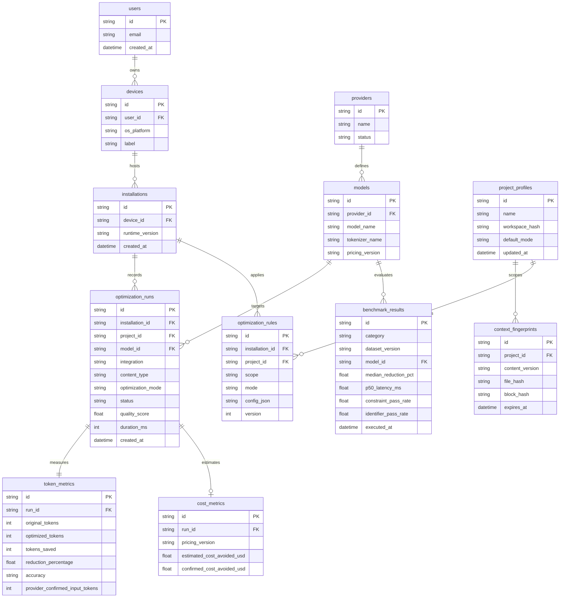

# Database and Storage Architecture

**Master Reference:** Sections 7.5, 7.6, 10, 11, and 17 of [token-optimization-platform-architecture.md](../token-optimization-platform-architecture.md).  
**Related ADR:** [ADR-0008](../decisions/ADR-0008-sqlite-local-and-postgresql-cloud-sync-boundaries.md), [ADR-0011](../decisions/ADR-0011-privacy-telemetry-retention-and-storage.md).  
**Reference DDL:** [schema.sql](./schema.sql).

---

## 1. Dual-Engine Storage Strategy

- **Local Persistence (`apps/local-runtime`):** **SQLite** (with FTS5 enabled for BM25/lexical relevance search over local project metadata and snippets). Runs completely offline with zero external dependencies.
- **Cloud Persistence (Optional Control Plane, MVP v0.5):** **PostgreSQL** for multi-device user accounts, synced rules, and aggregated analytics, paired optionally with **Redis** for rate limiting and caching, and **`pgvector`** strictly deferred to P2 if semantic retrieval benchmarks justify it.

---

## 2. Core Entities (12 Tables)

Matching Section 11:

| Table | Location | Sync Behavior | Purpose |
|---|---|---|---|
| `users` | Cloud (PostgreSQL) | Cloud-authoritative | Cloud user account identities |
| `installations` | Local + Cloud | Opt-in registration | Unique local runtime installations (`installation_id`) |
| `devices` | Local + Cloud | Opt-in sync | Registered workstations/clients linked to installations |
| `providers` | Local + Cloud | Registry pull / seed | Provider metadata (`openai`, `anthropic`, `google`, `local`) |
| `models` | Local + Cloud | Registry pull / seed | Model identifiers, tokenizer mappings, and versioned pricing refs |
| `optimization_runs` | Local + Cloud | Opt-in metadata sync | Run ID, integration, provider/model, mode, status, duration, methods |
| `token_metrics` | Local + Cloud | Opt-in metadata sync | Original, optimized, saved counts, accuracy (`exact`\|`estimated`), provider-confirmed counts |
| `cost_metrics` | Local + Cloud | Opt-in metadata sync | Estimated vs. provider-confirmed cost avoided and pricing version used |
| `project_profiles` | Local (primary) | Local-only by default | Workspace roots, language profile, ignore patterns, project settings |
| `context_fingerprints` | Local (primary) | Local-only (scoped) | Content/block hashes, freshness timestamps, file hashes scoped by project & version |
| `optimization_rules` | Local + Cloud | Opt-in bidirectional | User/project mode defaults, protected patterns, preservation policies |
| `benchmark_results` | Local / CI + Cloud | Opt-in / CI artifacts | Benchmark suite category, dataset version, pass rates, median savings, latency, paired quality results |

---

## 3. Entity-Relationship Diagram

---

## 4. Data Minimization & Privacy Rules

1. **Metadata-only default:** Store counts, timestamps, method arrays, validation outcomes, mode, accuracy tags, and duration — **never raw prompts, optimized prompts, source code, or terminal logs** by default.
2. **Explicit local history opt-in:** If a user enables local before/after history inspection in VS Code or Local Runtime settings, retained snippets stay strictly on disk locally with configurable retention TTL and one-click purge.
3. **Low-entropy hash warning:** Hashes (`block_hash`, `workspace_hash`) must **not** be treated as anonymization guarantees for low-entropy text and are excluded from default cloud telemetry sync.
4. **Fingerprint isolation:** `context_fingerprints` must include `project_id` and `content_version` / `file_hash` in composite lookup keys so cached context never leaks across unrelated workspaces or serves stale edits.
5. **SQLite FTS5 Usage:** Local lexical search indexes (`fts_workspace_files`) store chunk references and tokenized index entries scoped to authorized workspaces and invalidate automatically when `file_hash` / `mtime` changes.
