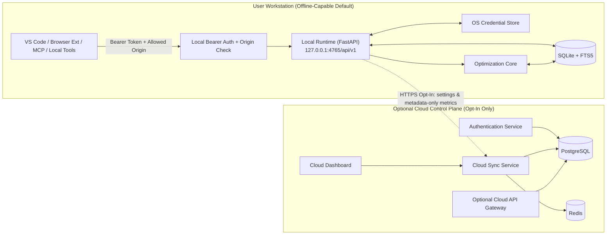

# Local Runtime and Cloud Control Plane Architecture

**Master Reference:** Sections 5, 11, 12, and 17 of [token-optimization-platform-architecture.md](../token-optimization-platform-architecture.md).  
**Related ADRs:** [ADR-0003](../decisions/ADR-0003-local-runtime-transport-and-auth.md), [ADR-0008](../decisions/ADR-0008-sqlite-local-and-postgresql-cloud-sync-boundaries.md), [ADR-0011](../decisions/ADR-0011-privacy-telemetry-retention-and-storage.md).

---

## 1. Architectural Split: Local-First Execution vs. Optional Cloud

Project T enforces a clean boundary between **local execution** (mandatory for core optimization) and **cloud coordination** (strictly optional).

---

## 2. Local Runtime (`apps/local-runtime`)

### 2.1 Network & Binding Rules
- **Default bind address:** `127.0.0.1:4765`
- **API base URL:** `http://127.0.0.1:4765/api/v1`
- **Prohibition:** Must **never** bind to `0.0.0.0` by default to avoid exposing local workspace context or endpoints on LAN/public interfaces.

### 2.2 Internal Module Layout
Matching Section 13:
- `src/server/` — FastAPI app factory, routers (`/health`, `/optimize`, `/count`, `/analyze`, `/context/*`, `/logs/compress`, `/metrics`, `/settings`, `/providers`), request validation, exception redaction middleware.
- `src/auth/` — Per-installation random token generator, OS keyring reader/writer, bearer validation, strict `Origin`/`Host`/CORS guard.
- `src/config/` — Typed runtime configuration (port, payload limits, timeout budgets, retention TTL, default mode, feature flags).
- `src/lifecycle/` — Startup initialization, SQLite schema migration check, graceful shutdown, health diagnostics, and lock/PID handling.

### 2.3 Offline Capability Matrix
| Capability | Offline Available? | Notes |
|---|---|---|
| Classification, constraint extraction, protected-span locking | Yes | Deterministic local rules/parsers |
| Exact deduplication & whitespace normalization | Yes | Local hashing & normalization |
| Rule-based & terminal log compression | Yes | Local heuristics |
| BM25 / SQLite FTS context selection | Yes | Local SQLite FTS5 index |
| Local tokenization (`tiktoken` / generic estimator) | Yes | Local tokenizers or `estimated` fallback |
| Remote provider token-count API (`exact` via Anthropic/Google APIs) | No | Falls back to local/estimated offline |
| Optional AI-assisted semantic compression (remote LLM) | No | Skipped offline unless local model configured |
| Cloud settings/analytics sync | No | Queued or deferred; never blocks optimization |

### 2.4 Local Runtime Security Controls
1. **Per-installation random token:** Generated at first boot using CSPRNG; rotated on user request.
2. **OS credential store:** Persist installation secrets and any optional provider credentials in OS keychain/Credential Manager/Secret Service where available.
3. **CORS restriction:** Explicit allowlist of authorized local/extension origins (`chrome-extension://<id>`, `vscode-webview://...`, configured local dashboard dev URL). Never use `Access-Control-Allow-Origin: *`.
4. **Origin & auth validation:** Validate both bearer token and `Origin`/`Host` headers on state-changing (`POST`, `PUT`, `DELETE`) and sensitive `GET` endpoints.
5. **Resource limits:** Enforce maximum request body bytes, per-request optimization timeout, and sliding-window rate limits to prevent local resource exhaustion.
6. **Explicit workspace approval:** Sensitive operations (indexing a new repository root via `/context/select`) require workspace allowlisting or user confirmation.

---

## 3. Cloud Control Plane (`services/` & `apps/dashboard`)

The Cloud Control Plane is deferred to **MVP v0.5** and operates strictly on explicit user opt-in.

### 3.1 Responsibilities
- **Authentication (`services/authentication`):** User accounts, installation pairing, device registration.
- **Settings Sync (`services/cloud-sync`):** Cross-device synchronization of `optimization_rules`, mode defaults, and non-secret preferences.
- **Aggregated Analytics (`services/analytics`):** Rollup views across devices/installations showing original vs. optimized tokens, estimated cost avoided, provider/model breakdowns, fallback rates, and latency trends.
- **Optional Cloud API Gateway:** Managed hosted gateway alternative for teams not running a self-hosted gateway.
- **Future Scope (Post-MVP):** Subscription management, shared team policies.

### 3.2 Sync Boundaries & Fail-Open Local Behavior
- If cloud authentication expires, network drops, or cloud services are unreachable, the Local Runtime continues operating at 100% deterministic capacity.
- Sync payloads **exclude** raw prompts, raw responses, source files, and terminal logs by default (see [Privacy & Data Handling](../security/privacy-and-data-handling.md)).
