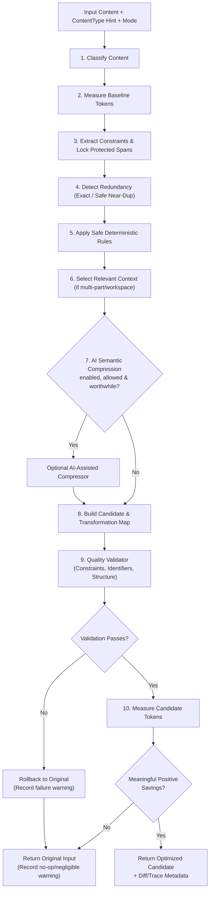

# Optimization Engine Design (`packages/optimization-core`)

**Master Reference:** Sections 3, 6, 7, 13, 20, and 21 of [token-optimization-platform-architecture.md](../token-optimization-platform-architecture.md).  
**Related ADRs:** [ADR-0002](../decisions/ADR-0002-python-engine-and-typescript-integrations.md), [ADR-0006](../decisions/ADR-0006-pipeline-ordering-and-fallback-policy.md), [ADR-0007](../decisions/ADR-0007-protected-spans-and-constraint-preservation.md).

---

## 1. Core Design Philosophy

`packages/optimization-core` is the intellectual property core of Project T. It is implemented in **Python 3.12+** as an isolated, library-only package with **zero dependencies** on FastAPI, VS Code, Chrome, or external HTTP servers.

Every optimization call passes through a deterministic-first, quality-validated, reversible pipeline that guarantees **zero silent degradation** via automatic original-content fallback.

---

## 2. Core Modules

Matching Sections 6.1 and 13:

| Module | Directory | Responsibility |
|---|---|---|
| **Content classifier** | `classifier/` | Identify `ContentType` (`prompt`, `developer_prompt`, `source_code`, `json`, `documentation`, `terminal_output`, `conversation`, `tool_result`), language, code presence, and constraint indicators |
| **Constraint extractor** | `constraints/` | Extract explicit requirements, negative prohibitions, target components, output formats, and protected spans across 10 categories |
| **Deduplication engine** | `deduplication/` | Safe line/whitespace normalization, stable block hashing for exact duplicates, optional SimHash/MinHash near-duplicate candidates scoped by project & version |
| **Semantic & rule compressor** | `compression/` | Safe whitespace reduction, deterministic filler/boilerplate phrasing removal, terminal log error-window extraction, structured summarization, and optional AI-assisted compressor hook |
| **Context selector & memory** | `context-selection/` | BM25 / SQLite FTS5 lexical ranking, symbol/import/test/freshness heuristics, and project-scoped `context_fingerprints` cache |
| **Token estimator** | `tokenization/` | Orchestrates `TokenizerAdapter` calls for baseline and candidate payloads, preserving `exact` vs `estimated` accuracy labels |
| **Quality validator** | `validation/` | Verifies hard preservation invariants (constraints, identifiers, paths, JSON/schema keys, tool args), calculates diagnostic score `Q`, and enforces rollback triggers |
| **Pipeline orchestrator** | `pipeline/` | Selects policy per mode (`safe`, `balanced`, `aggressive`), orders module execution, records reversible trace steps, enforces timeouts, and executes fallback |
| **Analytics emitter** | `pipeline/` / metrics hook | Produces structured run telemetry (methods used, token deltas, duration ms, warnings, validation outcome) without storing raw text by default |

---

## 3. Hybrid Optimization Pipeline Flow

---

## 4. Optimization Modes & Hard Invariants

| Mode | Allowed Transformations | Intended Use Case |
|---|---|---|
| **`safe`** | Safe whitespace normalization, exact duplicate block removal (non-code or strictly verified identical blocks), non-destructive terminal trimming; strict preservation | Source code, JSON/schemas, production tool contracts, critical system prompts (Default for code) |
| **`balanced`** | Exact + safe near-duplicate deduplication, deterministic rule-based prose compression, BM25 context filtering, optional approved semantic methods | General developer prompts, documentation, multi-turn summaries, IDE workflows |
| **`aggressive`** | Extensive deterministic + semantic summarization and pruning with strict validation, requiring explicit user selection | Very long context windows, archival conversation compaction, noisy logs where user accepts higher compression |

### Mode-Invariant Hard Rules
Regardless of whether the caller selects `safe`, `balanced`, or `aggressive`, the engine **NEVER** permits:
1. Renaming, truncating, or dropping function, class, or variable identifiers (when `preserve_identifiers` is enabled, and by default on code/developer prompts).
2. Dropping or softening explicit prohibitions (e.g., *"Do not alter the database schema"*).
3. Corrupting JSON keys, schema types, tool names, or tool argument contracts.
4. Altering version strings, configuration literals, API endpoints, HTTP methods, file paths, or line numbers.
5. Bypassing `QualityValidator` before returning an optimized candidate.

---

## 5. Reversibility & Fallback Guarantees

- **Reversible pipeline context:** Every stage appends structured transformation metadata (`method`, `span_affected`, `reason`, `tokens_delta_est`) rather than mutating input destructively in place without history.
- **Original preservation:** Every `OptimizationResult` includes `original_content` (in the immediate API response) and clients retain undo/restore controls.
- **Fail-safe triggers:** Any exception, timeout, negative/zero savings, below-threshold savings, or validation failure forces `optimized_content = original_content`, `tokens_saved = 0`, `validation_passed = false` (or warning flag for non-beneficial skip), ensuring zero task corruption.
