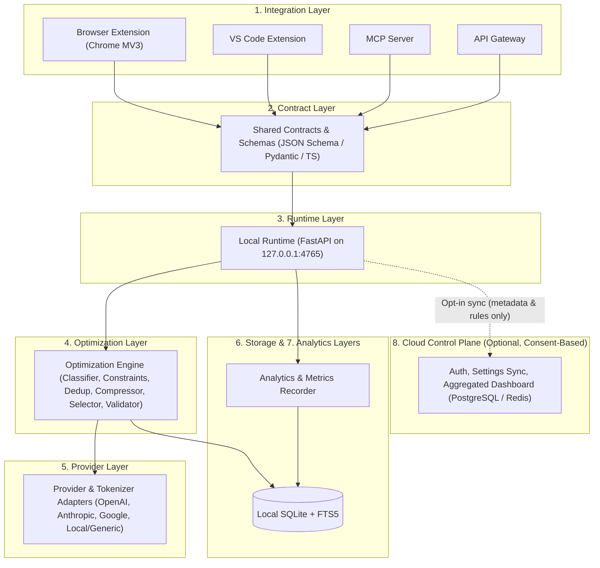
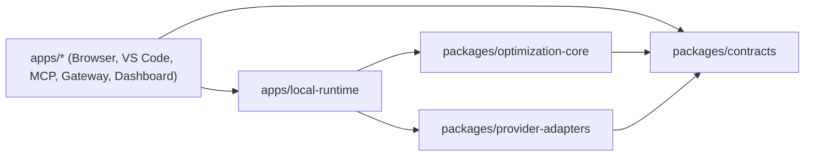

# System Overview

**Master Reference:** Sections 1, 2, 3, 4, and 13 of [token-optimization-platform-architecture.md](../token-optimization-platform-architecture.md).

---

## 1. Purpose and Core Promise

Project T is a **model-independent, local-first, quality-aware token optimization platform** designed to reduce unnecessary input tokens across AI prompts, conversation context, repository context, terminal output, documentation, and agent tool results while preserving task-critical information.

> **Core product promise:** Help users spend fewer tokens accomplishing the same work — not merely send shorter prompts.

---

## 2. Architectural Layers

Project T adopts a **modular monorepo** (avoiding microservices and Kubernetes in v1) partitioned into eight strictly layered responsibilities:

### Layer Responsibilities

| Layer | Package / App Location | Primary Responsibilities |
|---|---|---|
| **Integration Layer** | `apps/browser-extension`, `apps/vscode-extension`, `apps/mcp-server`, `apps/api-gateway` | Capture user-initiated inputs, enforce host-specific UX/safety rules, render previews, and proxy/reconcile API calls |
| **Contract Layer** | `packages/contracts` | Versioned JSON Schemas, OpenAPI definitions, Python Pydantic models, TypeScript types, and runtime validators |
| **Runtime Layer** | `apps/local-runtime` | Host the HTTP API on `127.0.0.1:4765`, per-install bearer auth, CORS/origin validation, lifecycle, limits, and settings |
| **Optimization Layer** | `packages/optimization-core` | Content classification, constraint & protected-span extraction, deduplication, compression, context selection, validation |
| **Provider Layer** | `packages/provider-adapters` | Provider-specific `TokenizerAdapter` implementations, request serializers, model registry, and versioned pricing metadata |
| **Storage Layer** | Local SQLite / Cloud PostgreSQL | Offline state, FTS lexical search, project-scoped context fingerprints, run metadata, optional cloud sync |
| **Analytics Layer** | `services/analytics`, local runtime recorder | Savings metrics, `exact` vs `estimated` accuracy labels, latency, validation failure/fallback rates, cost avoided |
| **Cloud Control Plane** | `apps/dashboard`, `services/authentication`, `services/cloud-sync` | Optional multi-device identity, settings sync, aggregated analytics dashboard, optional cloud-hosted gateway |

---

## 3. Component Priorities

| Component | Responsibility | Initial Priority | Target MVP |
|---|---|---:|---|
| **Local runtime** | Provide local authenticated API and host the optimization engine | P0 | v0.1 |
| **Optimization core** | Deterministic + optional semantic pipeline and quality validator | P0 | v0.1 |
| **VS Code extension** | Optimize selected prompts, workspace context, and terminal output | P0 | v0.2 |
| **Browser extension** | Optimize user-submitted prompts on supported web AI sites | P1 | v0.3 |
| **MCP server** | Expose typed optimization tools to compatible AI clients | P1 | v0.4 |
| **API gateway** | Normalize/optimize routed API requests and reconcile usage | P1 | v0.4 |
| **Cloud dashboard** | Usage analytics, account settings, optional cross-device sync | P2 | v0.5 |

---

## 4. Architectural Principles & Dependency Rules

All ten principles from Section 3 govern design reviews and pull requests:

1. **Engine independence:** `packages/optimization-core` must **never** import browser, VS Code, dashboard, gateway, FastAPI, or external provider SDK modules.
2. **Local-first:** Core deterministic optimization and local tokenization must run without a cloud account or network connection.
3. **Deterministic first:** Execute inexpensive, explainable rules before optional AI-assisted semantic compression.
4. **Quality-aware:** Evaluate every candidate against constraint, structure, and identifier preservation checks.
5. **Reversible:** Preserve original content and allow immediate recovery; avoid destructive silent edits.
6. **Provider-aware:** Token counting and request serialization respect target provider/model contracts.
7. **Fail-safe:** If validation fails, savings are negligible/non-positive, or any error occurs, return the original content untouched.
8. **Privacy by default:** Raw prompts, source code, and terminal output stay local unless the user explicitly opts into a cloud feature.
9. **Observable:** Emit structured records of applied methods, accuracy labels, latency, warnings, and validation outcomes.
10. **Extensible:** Add new providers, tokenizers, and site adapters behind stable contract interfaces.

### Forbidden Dependency Directions

- `packages/optimization-core` **MUST NOT** depend on `apps/*` or `services/*`.
- `packages/contracts` **MUST NOT** depend on runtime or UI frameworks.
- Frontend apps (`browser-extension`, `dashboard`) **MUST NOT** bundle provider API keys or direct database credentials.
