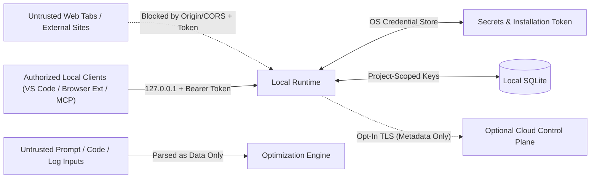

# Platform Threat Model

**Master Reference:** Sections 5.3, 9, and 17 of [token-optimization-platform-architecture.md](../token-optimization-platform-architecture.md).

---

## 1. Trust Boundaries

---

## 2. Threat Matrix (Section 17)

| Threat | Attack Vector / Failure Mode | Mandatory Mitigation |
|---|---|---|
| **API key leakage** | Provider API keys bundled into Chrome extension, frontend JS, plaintext config, or exception logs | Store secrets in OS credential store or managed secret storage; never bundle keys in browser/frontend code; redact secrets from logs & errors |
| **Malicious prompt content** | Prompt injection payloads inside source files, terminal logs, or web text attempting to hijack MCP tools, execute commands, or bypass parser rules | Treat all input strictly as untrusted data; prohibit shell execution in optimization tools; validate schemas and enforce strict payload limits |
| **Localhost abuse** | Malicious webpage or local process attempts CSRF, DNS rebinding, or unauthorized calls to `127.0.0.1:4765` | Require CSPRNG per-installation bearer token; validate `Origin` and `Host` headers; enforce strict non-wildcard CORS; bind only `127.0.0.1`; apply rate limits |
| **Source code exposure** | Proprietary source code or prompts uploaded implicitly to cloud servers or telemetry pipelines | Local-first execution by default; explicit opt-in required for any cloud upload; metadata-only analytics default; no raw prompt/code storage in telemetry |
| **Cache contamination** | Cached context fingerprints or deduplication entries collide or serve content from another workspace/project | Key `context_fingerprints` strictly by `(project_id, content_version, block_hash)`; prohibit cross-project fingerprint sharing |
| **Incorrect compression** | Aggressive rewriting drops a negative constraint (`Do not...`), alters a variable/function name, or breaks JSON schemas | Pre-lock constraints and 10 protected-span categories; run `QualityValidator` post-pass; enforce reversible changes and automatic original-content fallback |
| **Context poisoning** | Untrusted or unverified snippets injected into project memory/context packs without provenance | Record provenance, source file attribution, and content hashes/freshness checks on all context items |
| **Browser data exposure** | Browser extension reads unrelated tabs, passwords, cookies, or full page contents beyond prompt fields | Request minimal Manifest V3 host permissions (supported sites only); act only on explicit user action on prompt input fields |
| **Stale project memory** | Context selector returns outdated file content or stale hashes after local git/file edits | Store `file_hash` and `fresh_until`/timestamps; invalidate entries automatically on file modification or checksum mismatch |

---

## 3. Security Testing Requirements (`tests/security/`)

- Automated tests validating `401 Unauthorized` when bearer token is missing/invalid on protected `/api/v1/*` routes.
- Automated tests validating `403 Forbidden` for disallowed `Origin`/`Host` headers (DNS rebinding simulation) and path traversal attempts in `/context/select`.
- Secret-redaction tests confirming `Authorization` headers, API keys, and raw `content` never appear in FastAPI error logs or responses.
- Payload-size and rate-limit enforcement tests (`413`, `429`).
