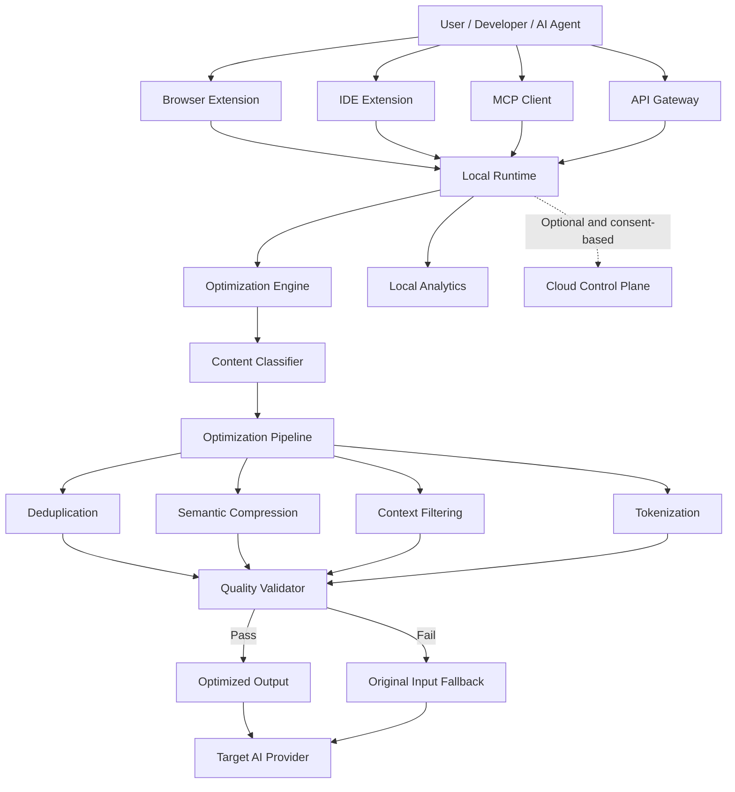
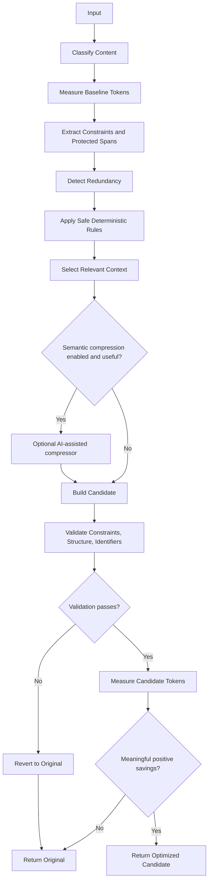
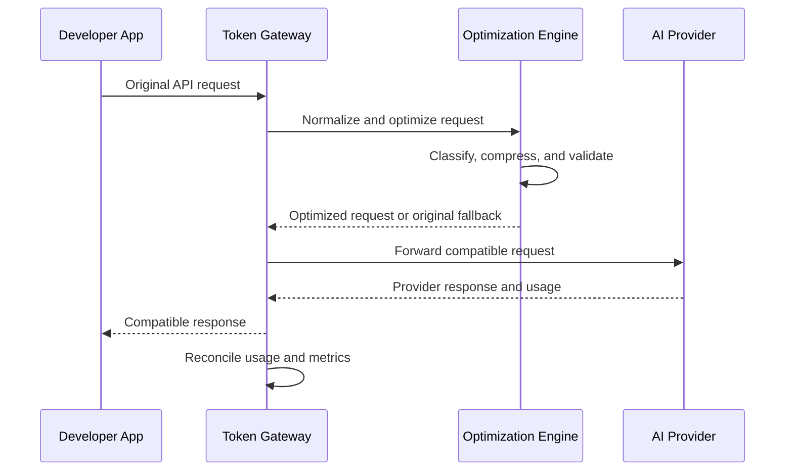

# Token Optimization Platform — Master Technical Architecture

**Document version:** 1.0  
**Working project name:** Project T (temporary; final brand undecided)  
**Architecture:** Modular monorepo, local-first runtime, optional cloud control plane  
**Optimization strategy:** Hybrid — deterministic algorithms first, optional AI-assisted semantic compression  
**Target integrations:** Browser extension, IDE extension, MCP server, API gateway

---

## 1. Executive Summary

Build a model-independent token optimization platform that reduces unnecessary input tokens across AI prompts, conversation context, repository context, terminal output, documentation, and agent tool results while preserving task-critical information.

The platform consists of:

1. **Browser extension** — user-controlled prompt optimization for supported AI websites such as ChatGPT, Claude, and Gemini.
2. **IDE extension** — workspace-aware context selection, prompt optimization, and terminal-output compression for VS Code and compatible environments.
3. **MCP server** — exposes optimization capabilities as tools to compatible AI clients and agentic IDEs.
4. **API gateway** — optimizes API requests routed through the gateway before forwarding them to supported model providers.
5. **Universal optimization engine** — shared classification, deduplication, context selection, compression, token estimation, validation, and analytics logic.
6. **Dashboard and cloud control plane** — optional account management, settings synchronization, and aggregated usage analytics.

The optimization engine must remain independent of the browser, IDE, gateway, and provider-specific integrations. New integrations should reuse the same engine and shared contracts.

### Product objectives

- Reduce unnecessary input tokens.
- Preserve intent, explicit constraints, identifiers, code symbols, and structured data.
- Improve context selection for coding agents.
- Reduce duplicated conversation and tool-result context.
- Support provider-specific token counting.
- Work locally without cloud access for supported operations.
- Measure token savings and task-quality impact transparently.

### Core product promise

> Help users spend fewer tokens accomplishing the same work — not merely send shorter prompts.

---

## 2. Product Scope and Components

| Component | Responsibility | Initial priority |
|---|---|---:|
| Browser extension | Optimize user-submitted prompts before submission | P1 |
| VS Code extension | Optimize selected prompts, workspace context, and terminal output | P0 |
| MCP server | Expose optimization tools to compatible clients | P1 |
| API gateway | Optimize requests and reconcile provider usage | P1 |
| Local runtime | Provide local API and host the optimization engine | P0 |
| Cloud dashboard | Usage analytics, account settings, optional synchronization | P2 |

### Integration limitations to respect

- A browser extension can optimize text that the user submits or explicitly selects. It must not assume access to private internal platform requests or hidden conversation context.
- A VS Code extension can optimize content it owns, controls, or receives through supported extension APIs. It cannot transparently rewrite every request generated by every third-party AI extension.
- An API gateway can optimize requests only when an application routes those requests through the gateway.
- MCP provides tool interoperability for compatible clients; it does not grant universal access to an IDE's internal model traffic.
- Antigravity, Cursor, Windsurf, and other IDE integrations must be validated against their current supported extension and MCP interfaces before being advertised as supported.

---

## 3. Architecture Principles

1. **Engine independence:** Core optimization logic must not depend on browser, IDE, dashboard, gateway, or provider SDK code.
2. **Local-first:** Local optimization must work without a cloud account or cloud connection.
3. **Deterministic first:** Apply inexpensive, explainable algorithmic optimizations before optional AI-assisted compression.
4. **Quality-aware:** Every transformation must be evaluated for instruction, constraint, structure, and identifier preservation.
5. **Reversible:** Preserve original input and provide a way to recover it. Avoid destructive transformations.
6. **Provider-aware:** Token counting and request serialization must be model/provider-specific where possible.
7. **Fail-safe:** If validation fails, savings are negligible, or an operation errors, return the original content.
8. **Privacy by default:** Do not upload raw prompts, source code, or terminal output to the cloud unless the user explicitly enables a feature that requires it.
9. **Observable:** Record transformation methods, token-count accuracy, latency, warnings, and outcome metrics.
10. **Extensible:** Add providers and integrations through adapters and stable contracts.

---

## 4. High-Level Architecture



### Architecture style

Use a **modular monorepo** with a local optimization runtime and an optional cloud control plane. Do not begin with microservices. Keep modules independently testable and define clear interfaces so services can be split later if scale requires it.

### Main layers

| Layer | Responsibilities |
|---|---|
| Integration layer | Browser, IDE, MCP, SDK, and API gateway interfaces |
| Contract layer | Shared request/response schemas and versioned types |
| Runtime layer | Local API, authentication, configuration, lifecycle |
| Optimization layer | Classification, selection, deduplication, compression, validation |
| Provider layer | Tokenizer and model-provider adapters |
| Storage layer | Local SQLite and optional cloud PostgreSQL |
| Analytics layer | Token metrics, quality metrics, latency, cost estimates |
| Cloud control plane | Optional identity, settings sync, aggregated analytics |

---

## 5. Local Runtime and Cloud Control Plane

### 5.1 Local runtime

The local runtime is the default execution environment.

- Runs on the user's computer.
- Hosts the optimization engine and local API.
- Processes prompts and project context locally.
- Stores settings, cache metadata, and local metrics in SQLite.
- Supports offline operation for deterministic algorithms and locally available tokenizers.
- Exposes an authenticated localhost API.

Suggested default bind address:

```text
127.0.0.1:4765
```

Do not bind to `0.0.0.0` by default.

### 5.2 Cloud control plane

The cloud is optional and should initially provide:

- User authentication.
- Cross-device settings synchronization.
- Aggregated usage analytics.
- Subscription management in a later release.
- Shared optimization policy/configuration.
- Optional cloud-hosted API gateway.

Do not make cloud access a prerequisite for local optimization.

### 5.3 Local runtime security

- Generate a random per-installation authentication token.
- Store secrets using the operating system credential store where possible.
- Restrict CORS to known extension origins and configured local clients.
- Validate request origin and authentication on state-changing operations.
- Set request-body and execution-time limits.
- Apply rate limits.
- Require explicit approval for sensitive workspace operations.
- Do not expose the service to public network interfaces by default.

---

## 6. Optimization Engine Design

The optimization engine is the platform's core intellectual property. It should be a pipeline of independent, composable modules.

### 6.1 Core modules

| Module | Responsibility |
|---|---|
| Content classifier | Detect prompts, code, JSON, docs, logs, conversation history, and tool output |
| Constraint extractor | Identify explicit requirements, prohibitions, formats, and task boundaries |
| Context selector | Select task-relevant files, snippets, and historical context |
| Deduplication engine | Remove exact and near-duplicate content where safe |
| Semantic compressor | Apply structured or optional AI-assisted compression |
| Context memory | Store reusable project facts and context fingerprints with freshness metadata |
| Token estimator | Estimate tokens using model-specific tokenizers or provider APIs |
| Quality validator | Check constraints, identifiers, structure, and references |
| Analytics module | Measure savings, latency, optimization methods, and validation outcomes |
| Pipeline orchestrator | Apply policies, order transformations, and handle fallback |

### 6.2 Hybrid optimization pipeline

The default pipeline should run deterministic operations first. AI-assisted compression is optional and should be used only when the configured policy allows it and the expected benefit justifies its additional cost and latency.



### 6.3 Optimization modes

| Mode | Behavior | Recommended use |
|---|---|---|
| Safe | Only low-risk deterministic changes; strict preservation | Default for source code and critical instructions |
| Balanced | Deduplication, rule-based compression, context filtering, optional approved semantic methods | General prompts and developer workflows |
| Aggressive | More extensive summarization and pruning with strict validation and explicit user choice | Long context where user accepts greater risk |

The mode must not override hard preservation rules. For example, source identifiers and explicit constraints should remain protected in every mode.

---

## 7. Optimization Algorithms

### 7.1 Initial algorithm portfolio

| Algorithm | Purpose | Priority |
|---|---|---:|
| Exact deduplication | Identify repeated identical blocks | P0 |
| Whitespace normalization | Remove irrelevant formatting overhead where safe | P0 |
| Rule-based compression | Remove redundant phrasing without changing instructions | P0 |
| Terminal log filtering | Extract errors, warnings, relevant stack frames, and surrounding context | P0 |
| Identifier protection | Preserve code symbols, paths, endpoints, and literals | P0 |
| BM25 / lexical relevance | Rank files and snippets against a task description | P0 |
| Near-duplicate detection | Detect similar blocks using SimHash or MinHash | P1 |
| Structured summarization | Summarize known document/log structures using deterministic templates | P1 |
| Conversation compaction | Preserve goals, decisions, constraints, and unresolved tasks | P1 |
| AI-assisted semantic compression | Optional semantic rewrite using an LLM | P1 |
| Embedding retrieval | Semantic retrieval where benchmarks justify the added complexity | P2 |

### 7.2 Classification

Example input:

```text
Fix the authentication issue in my React application.
Check the JWT middleware and login API.
Do not change the database schema.
```

Example classifier output:

```json
{
  "type": "developer_instruction",
  "language": "en",
  "contains_code": false,
  "contains_constraints": true
}
```

### 7.3 Constraint extraction

Example structured representation:

```json
{
  "objective": "Fix authentication issue",
  "targets": ["JWT middleware", "login API"],
  "constraints": ["Do not change the database schema"]
}
```

### 7.4 Protected information

Depending on content type, preserve:

- Function, class, and variable names.
- Imports and type definitions.
- API endpoints and HTTP methods.
- Error codes and exact error messages when relevant.
- File paths and line references.
- JSON keys and schema requirements.
- Explicit user constraints and prohibitions.
- Tool names and tool arguments.
- Version numbers and configuration values.
- User-specified output formats.

### 7.5 Context selection

For coding tasks, context selection should consider:

- Task-description relevance.
- File names and paths.
- Symbol references and imports.
- Dependency relationships.
- Tests associated with target modules.
- Recent changes and file freshness.
- Explicitly pinned files from the user.

Start with BM25/SQLite FTS and lightweight repository structure analysis. Add embeddings only if benchmark results demonstrate a significant improvement.

### 7.6 Deduplication

Use a staged strategy:

1. Normalize safe whitespace and line endings.
2. Compute stable hashes for exact block comparison.
3. Detect repeated blocks within the same request.
4. Optionally use SimHash/MinHash for near-duplicate candidates.
5. Remove a candidate only when the transformation is safe for the content type.

Do not deduplicate code or structured data solely because text appears similar. Scope fingerprints by project and relevant content version to avoid cross-project leakage.

### 7.7 Terminal-output compression

Preserve:

- Command and exit code.
- First actionable error.
- Relevant stack trace frames.
- File paths and line numbers.
- Warnings tied to the failure.
- Relevant lines immediately before and after an error.
- Test names and summary counts.

Do not discard output that may be needed to diagnose a failure. Keep the original output accessible.

### 7.8 Token savings formula

```text
Savings % = ((Original tokens - Optimized tokens) / Original tokens) * 100
```

Record whether token counts are exact or estimated. Do not present estimated token savings as provider-confirmed savings.

### 7.9 Quality score

A provisional internal score can combine:

```text
Q = 0.35I + 0.25C + 0.20S + 0.20R
```

Where:

- `I` = intent preservation.
- `C` = constraint preservation.
- `S` = structural preservation.
- `R` = reference and identifier preservation.

Each component is normalized between 0 and 1.

This score is a diagnostic, not proof of semantic equivalence. Task-completion benchmarks and human review are required to establish quality.

---

## 8. Tokenizer and Provider Adapter Architecture

Do not build the platform around one tokenizer. The same text can have different token counts across models, and structured requests may include overhead not captured by plain-text tokenization.

### 8.1 Adapter interface

```typescript
interface TokenizerAdapter {
  provider: string;

  countText(
    text: string,
    model: string
  ): Promise<TokenCountResult>;

  countRequest?(
    request: ModelRequest
  ): Promise<TokenCountResult>;
}

interface TokenCountResult {
  count: number;
  accuracy: "exact" | "estimated";
  model: string;
  provider: string;
}
```

### 8.2 Initial adapters

- OpenAI tokenizer and provider counting endpoint where available.
- Anthropic provider message-counting endpoint where available.
- Google model-specific counting adapter.
- Local tokenizer fallback for supported models.
- Generic estimate for unsupported models, explicitly marked `estimated`.

### 8.3 Provider registry

Use a registry to resolve a provider/model to the correct tokenizer and request serializer. Keep model metadata and pricing data versioned. Pricing must not be hard-coded into optimization algorithms.

---

## 9. Integration Architecture

### 9.1 Browser extension

**Technology:** TypeScript, React, Chrome Manifest V3.

Data flow:

```text
Supported AI website
    -> User action / prompt field
    -> Content script
    -> Prompt extractor
    -> Extension background/service worker
    -> Authenticated local runtime
    -> Optimization result
    -> User review and accept/reject
    -> User submits prompt
```

MVP features:

- Detect supported prompt input areas.
- Optimize prompt after explicit user action.
- Show original and optimized content.
- Show token estimate and reduction percentage.
- Allow accept, reject, and restore original.
- Provide site-specific adapters behind a common interface.
- Keep permissions restricted to supported sites.

Do not collect passwords, cookies, unrelated page content, or hidden conversation data.

### 9.2 VS Code extension

**Technology:** TypeScript and VS Code Extension API.

MVP features:

- Command to optimize selected text.
- Command to analyze selected prompt/context.
- Workspace file relevance analysis.
- Terminal output compression for user-selected output.
- Before/after preview.
- Token estimates.
- Local runtime connection and health check.
- Optimization history view.

Later features:

- Native language-model tools where supported.
- MCP integration.
- Context pack generation for agent workflows.
- Project profile and freshness-aware context memory.

A normal extension must not claim it can rewrite all third-party AI extension traffic.

### 9.3 MCP server

Expose tools with narrow, typed contracts:

```text
optimize_prompt
analyze_context
compress_terminal_output
select_relevant_files
deduplicate_context
estimate_tokens
get_optimization_report
```

Requirements:

- Validate all tool arguments.
- Apply per-tool input limits.
- Treat tool input as untrusted data.
- Do not execute arbitrary shell commands as part of optimization.
- Return structured results and warnings.
- Keep original content recoverable.
- Document which tools are local-only and which may use cloud services.

### 9.4 API gateway

Data flow:



Gateway requirements:

- Provider routing and request normalization.
- Secure API key management.
- Request and response schema compatibility.
- Streaming support.
- Error handling and retry policy.
- Idempotency safeguards.
- Provider usage reconciliation.
- Versioned pricing calculations.
- Optional bypass mode.
- Logging with sensitive data redacted.

Never silently alter tool schemas, function arguments, JSON contracts, or structured-output requirements.

### 9.5 Cloud dashboard

Core views:

- Original vs optimized token counts.
- Tokens saved.
- Estimated cost avoided.
- Provider/model breakdown.
- Integration breakdown.
- Daily/weekly/monthly trend.
- Optimization modes and methods.
- Validation failures and fallback rates.
- Quality benchmark summaries.
- Optimization latency.

---

## 10. Technology Stack

| Layer | Technology | Purpose |
|---|---|---|
| Monorepo | pnpm + Turborepo | Workspace management |
| Frontend | React + Vite | Dashboard and extension UIs |
| UI styling | Tailwind CSS | Shared styling |
| Browser | TypeScript + Manifest V3 | Browser integration |
| IDE | TypeScript + VS Code Extension API | IDE integration |
| MCP | Official MCP SDK | Agent interoperability |
| Core engine | Python 3.12+ | Optimization algorithms |
| API | FastAPI | Local and cloud HTTP API |
| Validation | Pydantic | Typed Python contracts |
| Lexical search | BM25 / SQLite FTS | Context relevance |
| Similarity | SimHash / MinHash | Near-duplicate candidates |
| Local database | SQLite | Offline persistence |
| Cloud database | PostgreSQL | Cloud persistence |
| Cloud cache | Redis | Optional caching and rate limits |
| Vector extension | pgvector | Optional later semantic retrieval |
| Python tests | Pytest | Core and API tests |
| TypeScript tests | Vitest | Shared packages and extensions |
| E2E | Playwright | Browser/dashboard flows |
| CI/CD | GitHub Actions | Automated quality checks |
| Packaging | Docker | Reproducible cloud packaging |

Avoid Kubernetes, a mandatory vector database, and complex microservices in the first release.

---

## 11. Database Architecture

Use SQLite locally and PostgreSQL in the cloud.

### Core entities

| Table | Purpose |
|---|---|
| `users` | Cloud user accounts |
| `installations` | Registered local installations |
| `devices` | Registered devices |
| `providers` | Provider configuration metadata |
| `models` | Model and tokenizer metadata |
| `optimization_runs` | Optimization run metadata |
| `token_metrics` | Token measurements and accuracy labels |
| `cost_metrics` | Cost estimates and provider-reported costs |
| `project_profiles` | Project context metadata |
| `context_fingerprints` | Deduplication and freshness metadata |
| `optimization_rules` | User and project optimization settings |
| `benchmark_results` | Quality and performance results |

### Example optimization record

```json
{
  "id": "run_001",
  "integration": "vscode",
  "provider": "openai",
  "model": "example-model",
  "original_tokens": 2400,
  "optimized_tokens": 1610,
  "tokens_saved": 790,
  "reduction_percentage": 32.92,
  "quality_score": 0.98,
  "optimization_mode": "balanced",
  "status": "validated",
  "accuracy": "estimated"
}
```

This is illustrative data, not a benchmark result.

### Data minimization

By default, store metadata such as counts, timestamps, method names, hashes, and validation outcomes rather than raw prompts or source code. Raw content retention must be explicit, configurable, and local by default.

---

## 12. API Design

Base local API:

```text
http://127.0.0.1:4765/api/v1
```

### Initial endpoints

| Endpoint | Method | Purpose |
|---|---|---|
| `/health` | GET | Runtime health |
| `/optimize` | POST | Optimize content |
| `/count` | POST | Count or estimate tokens |
| `/analyze` | POST | Analyze content |
| `/context/select` | POST | Select relevant files/snippets |
| `/context/compress` | POST | Compress context |
| `/logs/compress` | POST | Compress terminal output |
| `/metrics` | GET | Usage metrics |
| `/settings` | GET/PUT | Optimization settings |
| `/providers` | GET | Provider metadata |

### Example optimization request

```json
{
  "content": "Original content here",
  "content_type": "developer_prompt",
  "provider": "openai",
  "model": "example-model",
  "mode": "balanced",
  "optimization": {
    "deduplicate": true,
    "semantic_compression": true,
    "context_filtering": true,
    "preserve_identifiers": true
  }
}
```

### Example optimization response

```json
{
  "request_id": "req_example",
  "original_content": "Original content here",
  "optimized_content": "Optimized content here",
  "tokens": {
    "original": 1200,
    "optimized": 820,
    "saved": 380,
    "reduction_percentage": 31.67,
    "accuracy": "estimated"
  },
  "validation": {
    "passed": true,
    "constraints_preserved": true,
    "identifiers_preserved": true
  },
  "optimization": {
    "methods": ["deduplication", "rule_based_compression"],
    "mode": "balanced"
  },
  "duration_ms": 18,
  "warnings": []
}
```

### Shared TypeScript contracts

```typescript
export type OptimizationMode = "safe" | "balanced" | "aggressive";

export type ContentType =
  | "prompt"
  | "developer_prompt"
  | "source_code"
  | "json"
  | "documentation"
  | "terminal_output"
  | "conversation"
  | "tool_result";

export interface OptimizationRequest {
  content: string;
  contentType: ContentType;
  provider?: string;
  model?: string;
  mode: OptimizationMode;
  preserveIdentifiers: boolean;
}

export interface OptimizationResult {
  requestId: string;
  originalContent: string;
  optimizedContent: string;
  originalTokens: number;
  optimizedTokens: number;
  tokensSaved: number;
  reductionPercentage: number;
  validationPassed: boolean;
  accuracy: "exact" | "estimated";
  methods: string[];
  warnings: string[];
  durationMs: number;
}
```

Contracts must be versioned and validated at runtime. The Python and TypeScript representations should be generated from or checked against a canonical schema where practical.

---

## 13. Repository Structure

Recommended monorepo name: `project-t` (temporary).

```text
project-t/
│
├── apps/
│   ├── dashboard/
│   │   ├── src/
│   │   │   ├── components/
│   │   │   ├── pages/
│   │   │   ├── charts/
│   │   │   ├── hooks/
│   │   │   └── services/
│   │   └── package.json
│   │
│   ├── browser-extension/
│   │   ├── src/
│   │   │   ├── background/
│   │   │   ├── content/
│   │   │   ├── popup/
│   │   │   ├── options/
│   │   │   └── integrations/
│   │   ├── manifest.json
│   │   └── package.json
│   │
│   ├── vscode-extension/
│   │   ├── src/
│   │   │   ├── commands/
│   │   │   ├── providers/
│   │   │   ├── views/
│   │   │   ├── context/
│   │   │   ├── terminal/
│   │   │   └── runtime/
│   │   ├── package.json
│   │   └── tsconfig.json
│   │
│   ├── local-runtime/
│   │   ├── src/
│   │   │   ├── server/
│   │   │   ├── auth/
│   │   │   ├── config/
│   │   │   └── lifecycle/
│   │   └── pyproject.toml
│   │
│   ├── api-gateway/
│   │   ├── src/
│   │   │   ├── routes/
│   │   │   ├── middleware/
│   │   │   ├── providers/
│   │   │   ├── streaming/
│   │   │   └── usage/
│   │   └── pyproject.toml
│   │
│   └── mcp-server/
│       ├── src/
│       │   ├── tools/
│       │   ├── resources/
│       │   └── server.ts
│       └── package.json
│
├── packages/
│   ├── contracts/
│   │   ├── schemas/
│   │   └── types/
│   ├── optimization-core/
│   │   ├── classifier/
│   │   ├── constraints/
│   │   ├── deduplication/
│   │   ├── compression/
│   │   ├── context-selection/
│   │   ├── validation/
│   │   ├── tokenization/
│   │   └── pipeline/
│   ├── provider-adapters/
│   │   ├── openai/
│   │   ├── anthropic/
│   │   ├── google/
│   │   └── registry/
│   ├── shared-ui/
│   └── shared-utils/
│
├── services/
│   ├── analytics/
│   ├── authentication/
│   └── cloud-sync/
│
├── benchmarks/
│   ├── datasets/
│   ├── evaluation/
│   ├── reports/
│   └── runner/
│
├── tests/
│   ├── unit/
│   ├── integration/
│   ├── e2e/
│   ├── security/
│   └── regression/
│
├── infrastructure/
│   ├── docker/
│   ├── database/
│   ├── deployment/
│   └── monitoring/
│
├── docs/
│   ├── architecture/
│   ├── api/
│   ├── algorithms/
│   ├── security/
│   ├── benchmarks/
│   └── decisions/
│
├── scripts/
├── .github/
│   └── workflows/
├── docker-compose.yml
├── pnpm-workspace.yaml
├── turbo.json
├── pyproject.toml
├── README.md
├── CONTRIBUTING.md
└── LICENSE
```

### Repository boundaries

- `optimization-core` must not depend on browser or IDE implementation code.
- All integrations communicate through shared contracts.
- Provider-specific logic belongs in provider adapters.
- Local runtime must run without cloud services.
- No provider secrets in browser extension bundles or frontend code.
- Every optimization algorithm has independent tests and benchmark fixtures.
- Major architectural decisions are recorded as ADRs.

---

## 14. MVP Scope

### MVP v0.1 — Core engine and local runtime

**Must have:**

- Text/content classification.
- Exact deduplication.
- Safe whitespace normalization.
- Rule-based compression.
- Protected identifier and constraint handling.
- Token estimation interface.
- Quality validation and fallback.
- Safe, Balanced, and Aggressive policy modes.
- Local FastAPI runtime.
- SQLite metadata storage.
- Basic optimization report.
- Unit and regression tests.

**Should have:**

- Near-duplicate candidate detection.
- Terminal output filtering.
- Basic BM25 context selection.
- Reversible transformation records.

**Experimental:**

- Optional AI-assisted semantic compression.

### MVP v0.2 — Developer integration

- VS Code extension.
- Optimize selected text or prompts.
- Workspace file relevance analysis.
- Terminal output compression.
- Before/after comparison.
- Local runtime connection.
- Token savings preview.

### MVP v0.3 — Browser integration

- Chrome/Chromium Manifest V3 extension.
- Prompt optimization for supported ChatGPT, Claude, and Gemini interfaces.
- User-triggered rewriting.
- Original/optimized preview.
- Token estimation.
- Accept, reject, and restore controls.

### MVP v0.4 — MCP and API gateway

- MCP server and typed tools.
- OpenAI, Anthropic, and Google provider adapters.
- Request normalization.
- Streaming support.
- Provider usage reconciliation.
- Gateway bypass and fallback.

### MVP v0.5 — Cloud and analytics

- Dashboard.
- Cloud authentication.
- PostgreSQL.
- Optional analytics synchronization.
- Cross-device configuration.
- Docker deployment.

### Explicitly out of scope for first release

- Autonomous multi-agent orchestration.
- Custom foundation model training.
- Mandatory vector database.
- Kubernetes.
- Enterprise organization management.
- Billing/payment infrastructure.
- Universal interception of third-party AI traffic.
- Complex subscription tiers.

---

## 15. Phased Implementation Roadmap

The following is a planning estimate for a focused development effort, not a delivery guarantee.

| Week | Phase | Main work | Deliverable |
|---:|---|---|---|
| 1 | Foundation | Monorepo, tooling, shared contracts, CI, ADRs | Working repository foundation |
| 2 | Core engine | Classification, exact deduplication, rule-based compression, token adapter interface | Core engine alpha |
| 3 | Validation | Constraint extraction, protected identifiers, benchmarks, regression tests | Validated engine |
| 4 | Local runtime | FastAPI, SQLite, auth, settings, health and optimize endpoints | Local service |
| 5 | VS Code | Commands, sidebar, selected text, terminal output, preview | IDE alpha |
| 6 | Agent integration | MCP server, typed tools, VS Code MCP workflow, compatibility investigation | Agent integration alpha |
| 7 | Browser | Manifest V3, prompt field adapters, user review, supported site testing | Browser alpha |
| 8 | Gateway | Provider adapters, request normalization, streaming, usage reconciliation | Gateway alpha |
| 9 | Cloud | PostgreSQL, dashboard, auth, optional sync | Cloud beta |
| 10 | Release | E2E, security audit, benchmarks, documentation, packaging | Public MVP candidate |

### Recommended implementation order

Do not develop all integrations simultaneously. Build and validate the engine first, then add integrations one at a time. This avoids maintaining multiple user interfaces around an unproven optimization layer.

---

## 16. Testing and Benchmarking Strategy

The platform must demonstrate three things:

1. Fewer tokens are sent to the provider.
2. The model still completes the original task correctly.
3. Optimization overhead does not outweigh the savings.

### Benchmark categories

| Benchmark | Measures |
|---|---|
| Prompt benchmark | Intent and instruction preservation |
| Constraint benchmark | Preservation of required and forbidden actions |
| Code benchmark | Code-generation correctness and identifier preservation |
| Repository benchmark | Relevance and coverage of selected files |
| Log benchmark | Error extraction and diagnostic usefulness |
| Conversation benchmark | Retention of goals, decisions, and unresolved tasks |
| API benchmark | Actual provider-reported input tokens |
| Latency benchmark | Optimization processing overhead |

### Proposed initial acceptance targets

These are targets, not measured results.

| Metric | Initial target |
|---|---:|
| Deterministic unit test pass rate | 100% |
| Constraint preservation | 100% on curated protected-constraint tests |
| Identifier preservation | 100% on curated protected-identifier tests |
| Median token reduction | At least 15% on eligible benchmark inputs |
| Task-quality regression | No statistically meaningful degradation in paired tests |
| Small-input local latency | Under 100 ms on agreed reference hardware |
| Local runtime availability | 99% during controlled testing |

### Paired evaluation protocol

- Run the original prompt against a fixed model/version.
- Run the optimized prompt against the same model/version.
- Keep task, tools, settings, and sampling conditions equivalent.
- Compare objective assertions and task completion.
- Use human review for subjective tasks.
- Repeat across a representative dataset.
- Report failures and negative-savings cases.
- Do not use the optimizer's own quality score as the only evidence of quality.

### Important accounting distinctions

- **Estimated savings:** Based on a local tokenizer or estimator.
- **Provider-confirmed savings:** Based on the provider's request/usage reporting.
- **Cost avoided:** Calculated using the applicable, versioned model pricing and actual billable usage.

Do not equate token reduction with cost reduction unless provider pricing and billing behavior confirm it.

---

## 17. Security and Privacy

### Principles

- Local processing by default.
- No prompt or source-code uploads without consent.
- No API keys in browser storage or frontend bundles.
- Encrypt cloud credentials and sensitive configuration.
- Do not store raw code in analytics by default.
- Explicit cloud synchronization opt-in.
- Configurable retention and deletion.
- Secret redaction where appropriate.
- Authenticated localhost communication.
- User-controlled access to optimization history.

### Threat model

| Threat | Mitigation |
|---|---|
| API key leakage | OS credential store or managed secret storage |
| Malicious prompt content | Treat all input as untrusted data |
| Localhost abuse | Random auth token, origin validation, strict CORS |
| Source code exposure | Local-first processing and explicit cloud consent |
| Cache contamination | Project-scoped keys and content fingerprints |
| Incorrect compression | Validation, reversible changes, original fallback |
| Context poisoning | Provenance, source attribution, freshness checks |
| Browser data exposure | Minimal host permissions and explicit user actions |
| Stale project memory | File hashes, timestamps, invalidation, refresh |

### Data handling defaults

- Do not transmit raw content in analytics events.
- Hashes should not be treated as anonymization guarantees for low-entropy content.
- Avoid logging request bodies.
- Redact secrets from errors and traces.
- Make telemetry opt-in and explain exactly what is collected.

---

## 18. Git Workflow and Engineering Standards

### Branch strategy

```text
main
 develop

feature/optimization-core
feature/local-runtime
feature/vscode-extension
feature/mcp-server
feature/browser-extension
feature/api-gateway
feature/cloud-dashboard

fix/*
test/*
docs/*
```

### Rules

- Never develop directly on `main`.
- Use feature branches.
- Require pull requests.
- Run tests and lint checks before merging.
- Version shared contracts.
- Require architecture review for pipeline-breaking changes.
- Keep commits focused and reviewable.
- Tag releases using semantic versioning.

### Suggested release milestones

```text
v0.1.0  Core Engine
v0.2.0  Local Runtime
v0.3.0  IDE Integration
v0.4.0  Browser Integration
v0.5.0  MCP and Gateway
v1.0.0  Universal Platform MVP
```

---

## 19. Architecture Decision Records to Create

Create ADRs before implementation for these decisions:

1. Monorepo and workspace tooling.
2. Python optimization engine and TypeScript integration layer.
3. Local runtime transport and authentication.
4. Canonical API schema and contract generation.
5. Tokenizer adapter interface and exact/estimated labeling.
6. Optimization pipeline ordering and fallback policy.
7. Protected-span and constraint-preservation strategy.
8. Local SQLite schema and cloud PostgreSQL sync boundaries.
9. MCP tool naming and contracts.
10. Browser permissions and supported website adapter strategy.
11. Privacy, telemetry, retention, and content storage.
12. Benchmark methodology and release acceptance criteria.

Each ADR should include context, decision, alternatives, consequences, and review date.

---

## 20. First Engineering Milestone — Core Engine v0.1

### Objective

A developer can submit text to a local API, receive an optimized version, inspect exactly what changed, see token savings, and recover the original input.

### Required capabilities

1. Accept raw text and a content-type hint.
2. Classify content.
3. Extract and protect explicit constraints.
4. Detect exact duplicates.
5. Apply deterministic compression rules.
6. Preserve identifiers and critical spans.
7. Estimate or count tokens through an adapter.
8. Validate the candidate.
9. Revert to original on validation failure or no meaningful savings.
10. Return a structured optimization report.
11. Record metadata locally without storing raw content by default.
12. Include unit, integration, regression, and benchmark tests.

### Definition of done

- Local runtime starts and exposes a health endpoint.
- Optimization endpoint accepts a typed request.
- Original content is recoverable.
- Every transformation method is reported.
- Token count labels distinguish exact from estimated.
- Constraint and identifier tests pass.
- No-saving and validation-failure paths return the original.
- Benchmark runner produces reproducible reports.
- Documentation explains current limitations.

### Initial implementation sequence

1. Initialize repository and tooling.
2. Write ADRs and shared schemas.
3. Create Python optimization package.
4. Implement content classification.
5. Implement protected-span and constraint extraction.
6. Implement exact deduplication.
7. Implement safe rule-based compression.
8. Add tokenizer adapter interface and fallback estimator.
9. Implement quality validation and rollback.
10. Build benchmark fixtures and runner.
11. Create FastAPI local runtime.
12. Add integration tests and developer documentation.

---

## 21. Future Product Differentiators

### Context Efficiency Score

A future metric that estimates how much task-relevant information is delivered per token. It should be validated against task success and not treated as a universal measure of model intelligence.

### Adaptive optimization policy

Select optimization methods based on content type, risk level, model constraints, and expected savings. For example:

- Plain prompts: rule-based compression and deduplication.
- Source code: structural context selection and protected identifiers.
- Terminal logs: error extraction and relevant-context windows.
- Documentation: structure-aware summarization.
- Conversation history: decision, goal, constraint, and unresolved-task retention.
- Tool results: schema-aware filtering and duplicate-result elimination.

### Provider-independent observability

Show what was optimized, why it was optimized, what was preserved, how token counts were measured, and whether provider usage confirmed the savings.

---

## 22. Official Technical References

Use these as integration references and verify current documentation during implementation:

- VS Code AI extensibility: https://code.visualstudio.com/api/extension-guides/ai/ai-extensibility-overview
- VS Code MCP support: https://code.visualstudio.com/docs/copilot/chat/mcp-servers
- Model Context Protocol: https://modelcontextprotocol.io/
- OpenAI token counting: https://developers.openai.com/api/docs/guides/token-counting
- Anthropic token counting: https://platform.claude.com/docs/en/build-with-claude/token-counting
- Chrome Extensions documentation: https://developer.chrome.com/docs/extensions/
- FastAPI documentation: https://fastapi.tiangolo.com/
- Pydantic documentation: https://docs.pydantic.dev/

---

## 23. Final Recommendation

Build in this order:

1. **Foundation:** Core engine, contracts, benchmarks, and local runtime.
2. **Integrations:** VS Code, MCP, browser extension, and API gateway.
3. **Platform:** Cloud dashboard, analytics, security hardening, packaging, and release.

Do not build all integrations at once. Prove that the engine reduces tokens and preserves task performance before expanding the integration surface.

The defining product capability should be **quality-aware, cross-provider token optimization for both AI applications and agentic development workflows**.
